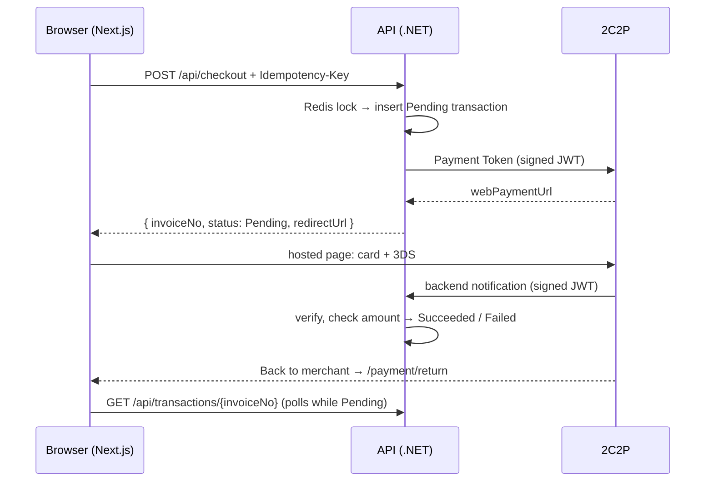

# Checkout with 2C2P

This is a small checkout app that takes payments through the **2C2P sandbox** (Payment API v4.3)
in **SGD**. One checkout page supports three ways to pay:

| Product / method              | 2C2P integration                                                | Confirmed by         |
| ----------------------------- | --------------------------------------------------------------- | -------------------- |
| OneTime, new payment method   | Redirect: hosted page with every method the merchant has        | Backend notification |
| Recurring, new payment method | Redirect: hosted page, card only, with "Save card" (`tokenize`) | Backend notification |
| Any product, saved card       | Direct API: Payment Token → Do Payment, with no hosted page     | Payment Inquiry      |

The checkout cannot charge twice for one purchase, whether the customer double-clicks, refreshes,
or retries on a slow network. Three guards ensure this: an `Idempotency-Key` per purchase, a Redis
distributed lock, and a MySQL unique index. An automated test against real MySQL and Redis proves
it ([details](#idempotency-and-locking)).

**Stack:**

- Backend: .NET 10 Web API (C#, clean architecture), EF Core + LINQ on MySQL 8, Redis.
- Frontend: Next.js 16, React 19, Tailwind 4.
- Everything starts with `docker compose up`.

## Quick start

You only need **Docker** (Docker Desktop with at least 4 GB of memory). No .NET SDK or Node.js is
required.

```bash
git clone <this repo> && cd checkout-2c2p
cp .env.example .env
# Edit .env: set TWOC2P_SECRET_KEY to the Singapore (JT01) secret key published on
# https://developer.2c2p.com/docs/sandbox
docker compose up --build
```

**Where the 2C2P secret key goes.** It is never committed. Use one of two git-ignored places:

| How you run it           | Put the key in                                                                                                             | Read as                                             |
| ------------------------ | -------------------------------------------------------------------------------------------------------------------------- | --------------------------------------------------- |
| `docker compose up`      | `.env` → `TWOC2P_SECRET_KEY` (copy `.env.example`)                                                                         | env var `TwoC2P__SecretKey`, set in `compose.yaml`  |
| `dotnet run` (no Docker) | `backend/src/Checkout.Api/appsettings.Development.json` → `TwoC2P:SecretKey` (copy `appsettings.Development.example.json`) | ASP.NET Core configuration, Development environment |

Both files are in `.gitignore`, and `appsettings.Development.json` is also kept out of the Docker
image (`backend/.dockerignore`). The merchant ID defaults to the sandbox's `JT01`.

The first build takes a few minutes. Then open:

| URL                           | What                                                   |
| ----------------------------- | ------------------------------------------------------ |
| http://localhost:3000         | The checkout                                           |
| http://localhost:8080/swagger | The API (Swagger UI, with examples for every endpoint) |

The database is created, migrated and seeded on startup with 3 customers and 4 products (2
OneTime, 2 Recurring). There is no separate database step.

**Paying in the sandbox**

| Card           | Number                | Result                                                                       |
| -------------- | --------------------- | ---------------------------------------------------------------------------- |
| Visa           | `4111 1111 1111 1111` | Succeeds. Use any future expiry, CVV `123`, and OTP `123456` on the 3DS page |
| Mastercard     | `5555 5555 5555 4444` | Succeeds, like the Visa (CVV `123`, OTP `123456`)                            |
| Visa, rejected | `4444 3333 2222 1111` | 2C2P's "Rejected Card": use it to test a failed payment and the retry        |

Test cards: https://developer.2c2p.com/docs/reference-test-information-sg (Singapore) and
https://developer.2c2p.com/docs/reference-testing-information (rejected card).

- After paying, the sandbox shows its own confirmation. Click **Back to merchant** to reach the
  result page.
- For a Recurring product, tick **Save card for future payment**. The card is then offered at
  checkout for that customer.

**Backend notification .** 2C2P can only post its notification to a public URL. Without
one, payments still settle: the result page polls and falls back to Payment Inquiry. To receive
real notifications, run a tunnel and restart the API:

```bash
cloudflared tunnel --protocol http2 --url http://localhost:8080   # or: ngrok http 8080
# put the printed https URL in .env as PUBLIC_API_URL, then:
docker compose up -d api
```

**Port already in use?** If 3306 or 6379 is taken, for example by a local MySQL or Redis, set
`MYSQL_HOST_PORT` / `REDIS_HOST_PORT` in `.env`. Ports 3000 and 8080 must be free.

```bash
docker compose down        # stop and keep the data
docker compose down -v     # stop and wipe the database (it is re-seeded on the next start)
```

## How a payment flows



A **saved card** skips the hosted page:

1. The API calls Payment Token with `customerToken` and `customerTokenOnly`, then Do Payment
   (plain JSON).
2. On `2000` it calls Payment Inquiry and settles the transaction (`0000` → Succeeded, otherwise
   Failed).
3. On `1001` it returns the bank's 3DS URL as `redirectUrl`. When the browser comes back from 3DS,
   the result page asks the API to run Payment Inquiry.

The result page always shows the status **from our database**, never from the redirect, because
the browser can return before or after the backend notification.

## Idempotency and locking

The client creates a UUID `Idempotency-Key` when the checkout page loads and sends it on every
retry of that purchase. Three guards stand behind it, each covering for the one before it
(`backend/src/Checkout.Application/Checkouts/CheckoutService.cs`):

1. **A Redis lock per key.** It is taken with `SET checkout:lock:{key} <owner> NX PX 90000` and
   released by a compare-and-delete Lua script, so only its owner can release it
   (`RedisDistributedLock.cs`). Because it lives in Redis, it holds across several API instances.
   A request that finds the lock held keeps retrying for up to 10 s:
   - If the first request finishes in that time, it gets the **same result**.
   - Otherwise it gets **409**.
2. **Replay.** Once a transaction exists for the key, the stored `invoiceNo`, `status` and
   `redirectUrl` are returned (header `Idempotent-Replayed: true`) and **2C2P is not called
   again**. The same key with a different body is rejected with **422**: a SHA-256 of the body is
   stored as `request_hash` and compared.
3. **A MySQL unique index on `idempotency_key`.** If the lock expires or Redis is down, every
   concurrent insert but one fails on the index. Those requests then replay, or get 409 while the
   first is still talking to 2C2P.

Payment results are written with a conditional `UPDATE … WHERE status = 'Pending'`
(`TransactionRepository.cs`, called by `PaymentConfirmationService.cs`). This has three effects:

- A repeated or late notification can never change a final status.
- The notification and Payment Inquiry can race safely.
- A success whose amount or currency differs from the stored transaction is never applied.

**Proof** (`backend/tests/Checkout.Api.Tests/Controllers/CheckoutConcurrencyTests.cs`). The
tests run against **real MySQL 8 and Redis** started by Testcontainers, with 2C2P faked and slowed
to 500 ms per call:

| Test                          | Result                                                                                      |
| ----------------------------- | ------------------------------------------------------------------------------------------- |
| 10 parallel requests, one key | Exactly 1 transaction row and 1 call to 2C2P. Observed: 1 created, 9 replayed               |
| The same with Redis down      | Still 1 row and 1 call. Observed: 1 created, 9 answered 409, 9 inserts blocked by the index |

The frontend adds two more guards:

- The Checkout button is disabled while a request is in flight.
- A synchronous guard drops a second click that lands before React re-renders. A real browser
  double-click had produced two requests, which the backend correctly folded into one
  transaction.

## API

Swagger UI is at **http://localhost:8080/swagger**. It documents every endpoint with request and
response examples, including the `Idempotency-Key` header. JSON is camelCase and enums are sent by
name. Errors are RFC 7807 problem details with a `traceId`.

| Method | Path                                    | Purpose                                                                                                                                                                                      |
| ------ | --------------------------------------- | -------------------------------------------------------------------------------------------------------------------------------------------------------------------------------------------- |
| GET    | `/api/customers`                        | Seeded customers (cached)                                                                                                                                                                    |
| GET    | `/api/products`                         | Seeded products (cached)                                                                                                                                                                     |
| GET    | `/api/customers/{id}/cards`             | A customer's saved cards, masked (cached); 404 for an unknown customer                                                                                                                       |
| POST   | `/api/checkout`                         | Body `{ customerId, productId, customerCardId? }`, header `Idempotency-Key`. Returns `{ invoiceNo, status, redirectUrl }`, where `redirectUrl` is `null` when a saved card needs no redirect |
| POST   | `/api/payments/2c2p/notification`       | 2C2P's `backendReturnUrl` (see below)                                                                                                                                                        |
| GET    | `/api/transactions/{invoiceNo}`         | Status and details for the result page, read fresh from MySQL on every call                                                                                                                  |
| POST   | `/api/transactions/{invoiceNo}/inquiry` | Payment Inquiry for a Pending transaction: a saved card after 3DS, or the fallback when a notification is late. Throttled to one call per invoice every 5 s                                  |
| GET    | `/api/health`                           | Liveness probe                                                                                                                                                                               |

`POST /api/checkout` answers:

| Status | When                                                                                                          |
| ------ | ------------------------------------------------------------------------------------------------------------- |
| 200    | Created, or a replay of the same key                                                                          |
| 400    | `Idempotency-Key` missing or not a UUID, or a malformed body                                                  |
| 409    | Another request with this key is still in progress after about 10 s                                           |
| 422    | Unknown customer or product, a card that is not this customer's, or the same key reused with a different body |

**Backend notification.** This endpoint is the source of truth for hosted-page payments. Only it
and Payment Inquiry can mark a transaction Succeeded. The handler:

1. Verifies the JWT (HS256, merchant secret key) and that its `merchantID` is ours, and rejects
   anything that fails with 400.
2. Finds the transaction by `invoiceNo` and checks the amount and currency.
3. On `0000`, sets Succeeded and saves `channelCode`, `accountNo`, `tranRef` and `paid_at`. On any
   other code, sets Failed with `respCode` and `respDesc`. Both changes apply only while the
   transaction is still Pending.
4. Saves a `customerToken` as a card once, guarded by a unique index, and clears that customer's
   cached card list.
5. Answers **200** for every verified notification, so 2C2P stops retrying: repeats, unknown
   invoices, and amount mismatches (which are logged and left Pending).

## Database

The schema is created by EF Core migrations
(`backend/src/Checkout.Infrastructure/Persistence/Migrations/`) and applied on startup. The same
schema as plain SQL is in [`backend/db/schema.sql`](backend/db/schema.sql), for reading.

The tables are `customer`, `product`, `transaction` and `customer_card`, with every column the
brief requires, plus the following:

| Addition / choice                                   | Why                                                                                                          |
| --------------------------------------------------- | ------------------------------------------------------------------------------------------------------------ |
| `transaction.flow` ENUM(`HostedPage`,`SavedCard`)   | How the transaction is confirmed: by notification or by Payment Inquiry                                      |
| `transaction.customer_card_id` (FK, nullable)       | Which saved card was charged                                                                                 |
| `transaction.request_hash` CHAR(64)                 | SHA-256 of the checkout body, so a reused key with a different purchase gets 422 instead of the wrong replay |
| `transaction.payment_token`                         | Needed for Do Payment, and useful for diagnosis                                                              |
| `transaction.redirect_url`                          | Lets a repeated key return the original hosted-page or 3DS URL without calling 2C2P                          |
| `transaction.updated_at`                            | When the row last changed                                                                                    |
| UNIQUE `idempotency_key`, UNIQUE `invoice_no`       | The final duplicate guard; 2C2P matches notifications by `invoiceNo`                                         |
| UNIQUE `customer_card(customer_id, customer_token)` | A repeated notification can't save a card twice                                                              |
| UNIQUE `customer.email`                             | Seeded customers are distinct people                                                                         |
| Fixed ids for `customer` and `product`              | The seed can run on every start without duplicating rows                                                     |
| Status and type columns as MySQL `ENUM`             | As in the brief; EF Core stores each enum by name                                                            |
| `DATETIME` always in UTC                            | MySQL `DATETIME` has no time zone, so a converter marks values read back as UTC                              |

**No card number or CVV is ever stored.** Only the 2C2P `customerToken` and the masked number
(`411111XXXXXX1111`) are kept.

**Seed data:**

- Customers: Wei Ling Tan, Arjun Nair, Siti Rahman.
- Products (SGD):
  - Yoga Drop-in Class, 35.00, OneTime
  - Personal Training Session, 90.00, OneTime
  - Monthly Unlimited Membership, 199.00, Recurring
  - Annual Studio Membership, 1890.00, Recurring

## Caching

Redis is used **cache-aside**, behind `ICacheService` (`RedisCacheService.cs`). Each service
reads in three plain steps: `GetAsync` from Redis; on a miss, load through the repository; then
`SetAsync` back into Redis.

| Key                             | Lifetime | Invalidation                                   |
| ------------------------------- | -------- | ---------------------------------------------- |
| `checkout:customers`            | 10 min   | Seeded; never changes at runtime               |
| `checkout:products`             | 10 min   | Seeded; never changes at runtime               |
| `checkout:customers:{id}:cards` | 5 min    | Removed when a card is saved for that customer |

- Transaction status is **never cached**.
- For these lookups Redis is an optimisation, not a dependency. If Redis is down, the read goes to
  MySQL in under 0.1 s and a warning is logged. The checkout lock is different: there the MySQL
  index is the fallback.

## Architecture

The backend follows a **Clean Architecture + Repository Pattern** standard: thin controllers,
use-case services, repository interfaces in Application implemented in Infrastructure, and a unit
of work for commits.

```
backend/src/
  Checkout.Api/                   HTTP edge; references Application, and Infrastructure only to register it
    Controllers/                  Health, Customers, Products, Checkout, PaymentNotifications, Transactions
    Contracts/Requests/           CheckoutRequest, NotificationRequest
    Contracts/Responses/          CustomerResponse, ProductResponse, CheckoutResponse, TransactionResponse, …
    Extensions/                   AddApi / UseApi, ResultExtensions (error code → status), ProblemDetailsCustomizer
    OpenApi/                      document settings, [ResponseExample]/[RequestExample] + ApiExamples
    Program.cs                    AddApplication() + AddInfrastructure() + AddApi(), then UseApi()
  Checkout.Application/           use cases; no EF Core, no 2C2P
    Abstractions/Persistence/     ICustomerRepository, IProductRepository, ICustomerCardRepository,
                                  ITransactionRepository, IUnitOfWork
    Abstractions/Caching/         ICacheService, IDistributedLock, CacheKeys
    Abstractions/Payments/        IPaymentGateway (provider-neutral) and its request/result types
    Common/                       Result<T>, ErrorCodes
    Configuration/                typed options bound with IOptions
    Customers/ Products/ Checkouts/ Payments/ Transactions/ Health/
                                  one folder per feature: service + interface, DTOs/, Validators/
    DependencyInjection.cs        AddApplication()
  Checkout.Domain/                no dependencies
    Entities/                     Customer, Product, PaymentTransaction, CustomerCard
    Enums/                        PaymentType, PaymentFlow, TransactionStatus
    Exceptions/                   PaymentGatewayException
  Checkout.Infrastructure/        implementations
    Persistence/                  AppDbContext, Configurations/, Migrations/, seed, UnitOfWork
    Repositories/                 CustomerRepository, ProductRepository, CustomerCardRepository, TransactionRepository
    Caching/                      RedisCacheService, RedisDistributedLock
    External/TwoC2P/              TwoC2PGateway : IPaymentGateway, HS256 JWT, wire formats, response codes
    DependencyInjection.cs        AddInfrastructure(), MigrateDatabaseAsync()
backend/tests/                    xUnit: Application (Moq unit tests), Infrastructure, Api (Testcontainers)
backend/db/schema.sql             the schema as SQL
frontend/                         Next.js app; every network call is in src/lib/api.ts
compose.yaml                      mysql, redis, api (:8080), web (:3000)
```

Dependencies point inward: Api → Application → Domain. Infrastructure implements the interfaces
in `Application/Abstractions`, and the Api references it only at the composition root
(`Program.cs`).

- **Controllers are thin.** They bind the request, call one service, and map the result to a
  response contract. Entities never reach the API.
- **Services return `Result<T>`**, never exceptions, for business outcomes such as an unknown
  product or a reused key. `Extensions/ResultExtensions.cs` maps each error code to its HTTP status
  and RFC 7807 problem details.
- **Repositories** have only the specific queries their use cases need (no generic repository),
  written with LINQ on EF Core. Reads use `AsNoTracking`.
- **Unit of work.** Repositories stage changes and the use case commits once with
  `IUnitOfWork.SaveChangesAsync`, all on the request's single `AppDbContext`. Two writes save at
  once on purpose, because a MySQL unique index must reject a duplicate right there:
  `TransactionRepository.TryAddAsync` (idempotency key) and
  `CustomerCardRepository.AddIfMissingAsync` (card saved once). Payment results are single
  conditional `ExecuteUpdate`s (`WHERE status = 'Pending'`), so a final status is never overwritten.
- **Options** bind from their `SectionName` and are validated at startup.
- **`ConfigureAwait(false)`** is used throughout Application and Infrastructure, enforced by
  CA2007.

**Where this deviates from the standard, and why:**

- **MySQL (Pomelo) instead of PostgreSQL**, as the brief requires.
- **Migrations run on startup** so `docker compose up` needs no extra step. In production, set
  `Database:MigrateOnStartup=false` and run them as a separate deployment step.
- **No pagination** on the customer and product lists: they are seeded, with 3 and 4 rows.

A new migration goes in `Persistence/Migrations`:
`dotnet ef migrations add <Name> -p src/Checkout.Infrastructure -s src/Checkout.Api -o Persistence/Migrations`.

## 2C2P integration

**The payment provider sits behind a provider-neutral interface.** `IPaymentGateway`
(`Application/Interfaces`) speaks in terms any provider has: `CreateSessionAsync`,
`ChargeSavedCardAsync`, `GetPaymentStatusAsync` and `ParseNotification`, with results such as
`PaymentStatus.Succeeded / Failed / Pending` and `ChargeOutcome.Submitted / RedirectRequired /
Declined`. The Application layer never sees a 2C2P code or field. Everything 2C2P-specific
(`"0000"`, `"CC"`, `tokenize`, `request3DS`, JWT, `merchantID`) lives in
`Infrastructure/External/TwoC2P/TwoC2PGateway.cs`. **Adding a second provider** means one class in
`External/<Provider>/` that implements `IPaymentGateway`, plus one DI registration; the services,
idempotency and database code don't change. The two-step shape (open a session, then charge a saved
card) matches how providers work: 2C2P Payment Token then Do Payment, or Stripe PaymentIntent create
then confirm.

| Call                 | Endpoint                           | Format                         |
| -------------------- | ---------------------------------- | ------------------------------ |
| Payment Token        | `POST /payment/4.3/paymenttoken`   | `{ "payload": JWT }` both ways |
| Do Payment           | `POST /payment/4.3/payment`        | Plain JSON                     |
| Payment Inquiry      | `POST /payment/4.3/paymentinquiry` | `{ "payload": JWT }` both ways |
| Backend notification | Received, not called               | `{ "payload": JWT }`           |

- **Payment rules.** `PaymentSessionRequest.ForCheckout` (Application) decides _what_ each case
  needs; `TwoC2PGateway` turns that into 2C2P fields. Every request also sets `invoiceNo`, `amount`,
  `currencyCode: "SGD"`, `frontendReturnUrl` and `backendReturnUrl`.

  | Case       | Neutral request            | 2C2P fields                                                                                      |
  | ---------- | -------------------------- | ------------------------------------------------------------------------------------------------ |
  | OneTime    | any method                 | No `paymentChannel`                                                                              |
  | Recurring  | card only, offer to save   | `paymentChannel: ["CC"]`, `tokenize: true`                                                       |
  | Saved card | card only, this saved card | `paymentChannel: ["CC"]`, `customerToken: [token]`, `customerTokenOnly: true`, `request3DS: "N"` |

- **Responses are trusted only after their signature verifies, and only for our merchant.** A
  notification or inquiry result whose `merchantID` isn't ours is rejected even when signed. A declined payment is a result,
  not an exception. Exceptions are reserved for an unreachable 2C2P, an HTTP error, a 30 s
  timeout, or an unreadable response.
- **Invoice numbers** are `INV` + the UTC date + 10 random digits: 21 characters, within 2C2P's
  limit of 50.

**What the live sandbox showed that the docs don't:**

- **Amounts settle in another currency.** The demo merchant `JT01` settles in THB. A SGD 35.00
  payment came back as `amount: 848.24 THB`, with `fxAmount: 35.0` and `fxCurrencyCode: "SGD"`.
  When the FX fields are present, the stored price is checked against them.
- **"Not found" means not paid yet.** For an invoice the customer hasn't paid yet, Payment Inquiry
  answers `2002 Transaction not found`, with `invoiceNo: null`. That code, and `0001`, `2001` and
  `4009`, mean "no outcome yet" and leave the transaction Pending. Treating them as failures would
  fail customers who are still on the payment page.
- **2C2P doesn't reject a reused invoice number.** It accepts a second Payment Token request for
  the same invoice, so our own idempotency is the only duplicate guard.
- **The channel code is the card scheme.** `channelCode` comes back as `VI` or `MA`, not `CC`.

## Frontend

| Route                 | What it does                                                                                                                                                                                                                                      |
| --------------------- | ------------------------------------------------------------------------------------------------------------------------------------------------------------------------------------------------------------------------------------------------- |
| `/`                   | Checkout with customer and product dropdowns, a payment summary, the customer's saved cards plus "Pay with a new payment method", and a Checkout button disabled while in flight. `?customerId&productId` preselects a purchase (used by Go back) |
| `/payment/return`     | `frontendReturnUrl`. Accepts 2C2P's GET or form POST and redirects (303) to the result page                                                                                                                                                       |
| `/result/[invoiceNo]` | Polls every 3 s while Pending. A saved card is confirmed with Payment Inquiry at once; a hosted-page payment after 10 s, as a fallback. Shows the success details, or the failure reason with **Go back**                                         |

The idempotency key is created in the browser after the page mounts, never while the page is
prerendered, where every visitor would share it.

- A retry, including an automatic retry after a 409, reuses the key.
- A changed selection after an attempt gets a new key, because it is a different purchase.

## Tests

```bash
cd backend && dotnet test     # 108 tests (xUnit); needs Docker (Testcontainers starts MySQL and Redis)
cd frontend && pnpm test      # 18 tests (Vitest + Testing Library)
```

| Area                 | Covered                                                                                                                                                                                                                                               |
| -------------------- | ----------------------------------------------------------------------------------------------------------------------------------------------------------------------------------------------------------------------------------------------------- |
| Idempotency          | 10 parallel requests with one key (with and without Redis); replay; key reused with a different body; missing or invalid key                                                                                                                          |
| Checkout             | Payment rules for each flow; unknown customer or product; another customer's card; decline; 2C2P unreachable; saved card with 3DS, with inquiry success, and with inquiry decline; wrong amount                                                       |
| Notification         | Success; decline; bad signature; malformed body; wrong amount; late decline after success; unknown invoice; card saved once across 13 repeated or concurrent notifications; cached card list cleared                                                  |
| Transactions         | Fresh reads; 404; inquiry `2002` stays Pending; throttling; 3DS return; notification racing an inquiry                                                                                                                                                |
| 2C2P gateway         | Request shapes per case, URLs and signing against a stub; 2C2P codes mapped to neutral statuses; JWT interoperability; forged, tampered and `alg: none` tokens rejected; another `merchantID` rejected; a recorded sandbox FX payload                 |
| Services (unit, Moq) | CheckoutService: validation, not-found codes, replay without calling 2C2P, reused key, in-progress, index-blocked insert; PaymentConfirmationService: pending, amount mismatch, card saved and cache cleared, already final; CheckoutRequestValidator |
| Frontend             | Disabled while in flight; double-submit guard; same key on 409 retry; new key after a selection change; result states; Go back; return handler                                                                                                        |

Three more tests call the **real** sandbox. They are skipped unless a key is set:

```bash
cd backend && set -a && source ../.env && set +a && dotnet test --filter Category=Sandbox
```

**Verified by hand against the live sandbox,** through the UI in Docker, with real notifications
over a Cloudflare tunnel:

| Scenario                    | Result                                                                                                                                                                                    |
| --------------------------- | ----------------------------------------------------------------------------------------------------------------------------------------------------------------------------------------- |
| OneTime, Visa + 3DS         | Hosted page with every method → Succeeded                                                                                                                                                 |
| Recurring, Mastercard       | Card-only page with Save card → declined `4081` → Failed, reason shown, Go back preselects. (On 12 Oct the sandbox accepted this card, so use the rejected Visa above to test a failure.) |
| Recurring, Visa + Save card | Succeeded; the card was saved from the real `customerToken` and offered at checkout                                                                                                       |
| Saved card                  | Payment Token `0000` → Do Payment `2000` → Inquiry `0000` → Succeeded, no redirect                                                                                                        |
| No tunnel                   | Result page settled the hosted payment through the inquiry fallback in about 13 s                                                                                                         |

## Assumptions

- **2C2P sandbox only**, with the public Singapore demo merchant `JT01` and Payment API v4.3.
  Every price is in **SGD**.
- **Customers and products are seeded and fixed** (3 customers, 4 products). Prices never change
  at runtime, so a transaction copies the product's price and currency when it is created.
- **No login.** Anyone can pick any customer, as the brief allows. A saved card is only offered to
  the customer it belongs to, and checkout rejects another customer's card id.
- **"Recurring" means the card is saved as a 2C2P token** for later payments. Nothing charges it on
  a schedule.
- **A card is saved only when the customer ticks "save card"** on the hosted page. If a successful
  result has no `customerToken`, the payment is recorded and no card is created.
- **One purchase = one `Idempotency-Key`**, created by the browser when the checkout page loads.
  A retry reuses it. Reloading the page or changing the selection is a new purchase.
- **The backend notification is the source of truth** for hosted-page payments. It needs a public
  URL, so locally the result page falls back to Payment Inquiry.
- **The customer pays the amount we asked for.** JT01 settles in THB, so the amount check uses
  2C2P's `fxAmount`/`fxCurrencyCode` (the SGD charged) when they are present.
- **Saved-card payments skip 3DS on the token** (`request3DS: "N"`), and are still sent to the 3DS
  page if the bank asks for it (Do Payment `1001`).

## Trade-offs and decisions

- **.NET 10 with EF Core 9.** Pomelo, the MySQL provider the brief suggests, has no EF Core 10
  release yet, and EF Core 9 runs on .NET 10. When Pomelo ships 10.x, upgrading means changing
  versions in `backend/Directory.Packages.props` and `backend/.config/dotnet-tools.json`.
- **A small hand-written HS256 JWT** instead of a JWT library (about 40 lines). It accepts only
  HS256, so a token's header cannot switch it to `none`. It compares signatures in constant time,
  and a test checks it against a standard HS256 token.
- **Waiting on the lock, then 409.** A concurrent duplicate usually gets the same 200 response
  rather than an error, which is friendlier for a double-click. The wait is capped at 10 s.
- **When 2C2P fails, the step decides the status.**
  - If the payment token can't be obtained, the transaction fails at once: no payment page ever
    reached the customer, so no charge can follow.
  - If Do Payment or Inquiry times out, the transaction stays **Pending**, because the charge may
    have happened. Payment Inquiry settles it later.
- **An amount mismatch is left Pending and logged**, not marked Failed. It needs a person to look
  at it, not an automatic decision either way.
- **422 for unknown ids in the body**, with field errors in the problem details. 404 is used only
  for resources in the URL.
- **Every verified notification gets 200**, even a repeat or an unknown invoice, so 2C2P stops
  retrying. Only an invalid signature gets 400.
- **The inquiry fallback is driven by the result page**, not by a background job. It is simple and
  enough here, but it only runs while someone is on that page.

## Out of scope, and next steps

As the brief specifies, there is no login or authentication, no CRUD for products or customers,
no refunds, no scheduled recurring charges, and no production deployment.

With more time, I would add:

- A background reconciliation job that runs Payment Inquiry for transactions left Pending, for
  example when a customer closes the tab before a notification arrives.
- A log table of raw notifications, for audit and support.
- An automated browser test for the hosted-page flow (it was verified by hand).
- Readiness checks for MySQL and Redis, plus metrics and tracing.
- Clean-up of old idempotency records.

## Developing without Docker

```bash
docker compose up -d mysql redis
cd backend && dotnet run --project src/Checkout.Api     # .NET 10 SDK, http://127.0.0.1:8080
cd frontend && pnpm install && pnpm dev                  # Node 22, http://localhost:3000
```

Before the first run, create your local settings and add the 2C2P key:

```bash
cp backend/src/Checkout.Api/appsettings.Development.example.json \
   backend/src/Checkout.Api/appsettings.Development.json
# then set "TwoC2P": { "SecretKey": "<Singapore JT01 secret key>" }   (git-ignored)
```

From the host, the API uses `backend/src/Checkout.Api/appsettings.json`, which expects MySQL on
3306 and Redis on 6379. If your ports differ, override the connection strings in the same
`appsettings.Development.json`, for example
`"ConnectionStrings": { "Default": "Server=127.0.0.1;Port=3307;…" }`.

## 2C2P references

| Topic                              | Link                                                               |
| ---------------------------------- | ------------------------------------------------------------------ |
| How the Redirect flow works        | https://developer.2c2p.com/docs/redirect-api-how-it-works          |
| Sandbox merchant ID and secret key | https://developer.2c2p.com/docs/sandbox                            |
| Test cards (Singapore)             | https://developer.2c2p.com/docs/reference-testing-information      |
| Backend notification               | https://developer.2c2p.com/docs/api-payment-response-backend       |
| Saving a card as a customer token  | https://developer.2c2p.com/docs/redirect-api-card-tokenization     |
| Paying with a saved card           | https://developer.2c2p.com/docs/direct-api-payment-with-card-token |
| Payment Inquiry                    | https://developer.2c2p.com/docs/api-payment-inquiry                |
| JWT                                | https://developer.2c2p.com/docs/json-web-tokens-jwt                |
| Response codes                     | https://developer.2c2p.com/docs/response-code-payment              |
